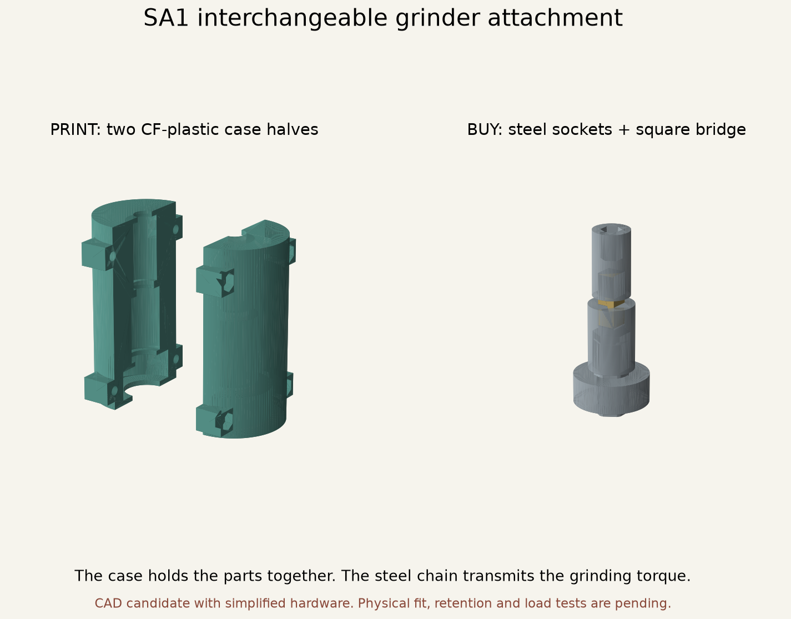
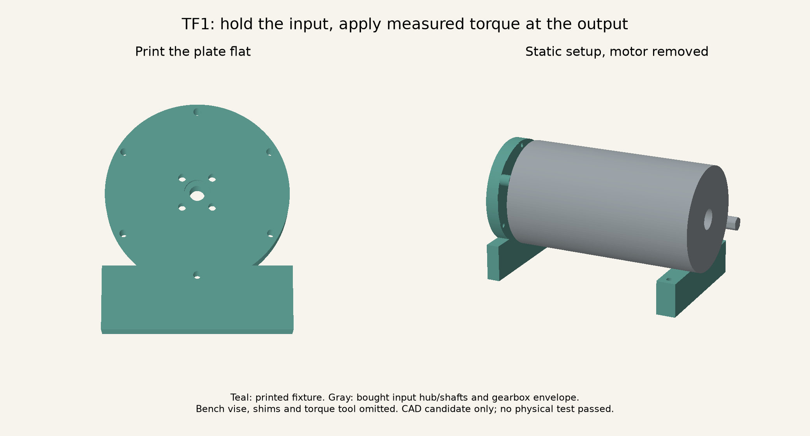

# D1 prototype build guide

This is an experimental build for fit and controlled load testing. No parts have been printed or physically tested for this project. Do the small fit checks first. Do not buy the full bill of materials or connect the grinder based solely on a clean CAD report.

## Printed plastic and purchased metal

You do not need a metal printer. All sun gears, planet gears, stationary ring gears, carrier plates and housing pieces are plastic prints. The separate grinder adapter is also a plastic test part. A carrier is the plate holding the small planet gears; it turns the next shaft.

Bearings, shoulder bolts, shafts, shaft connectors, two clamping hubs and fasteners are purchased hardware. Some spacer tubes and housing tie rods require cutting and finishing to length, or a supplier's cutting service. A hub is a small connector bolted onto a printed carrier that grips its shaft. The later two carriers use metal hubs because their short plastic shaft sockets concentrated too much load into too little contact area. This does not replace any of the gear teeth with metal.

Drive-shaft and bearing STLs named `spacer` are dimensional fit samples for the metal pieces. Their existence does not mean they should be printed for powered operation. The separately named TF1 static-fixture standoffs are plastic. `REFERENCE.step` files show an assembly and must not be printed as one object. The part material and quantity are recorded in each validation report.

This is an **assemble-after-printing** design. Print the sun, planets, ring and carrier plates separately, remove any brim, check the fits, then install bearings and metal pins during the assembly sequence below. You can place several separate pieces on one print bed. Their nested positions in a CAD preview do not mean that they print in those positions. A print-in-place mechanism would need different bearing, pin, clearance and service-access arrangements; it is not what these files describe.

## Exact filament and why

**Next-test candidate: Prusament PC Blend Carbon Fiber, PCCF.** This is polycarbonate blend containing chopped carbon fibers. It is a filament for an appropriately equipped FDM printer. No continuous-fiber or metal-printing equipment is required. This choice replaces the earlier provisional unfilled-PC baseline, not a successful physical material test.

| Candidate | Evidence relevant to this design | Decision |
| --- | --- | --- |
| Prusament PCCF | Manufacturer horizontal printed tensile yield 64 ± 3 MPa, horizontal tensile modulus 2.6 ± 0.1 GPa; separate interlayer adhesion test 23 ± 2 MPa. No gear fatigue or wear rating supplied. | Use for next fit and controlled stage tests. Dimensional stability is useful for multiple bearing seats. |
| Unfilled Prusament PC Blend | Earlier baseline: published tensile yield 63 ± 1 MPa. The numbers do not show a large tensile-strength improvement simply from adding CF. | Retain as an alternative comparison material; do not silently substitute. |
| Bambu PAHT-CF | Manufacturer dry XY/Z bending values 125/61 MPa and wet values 115/49 MPa. These are different tests and processing conditions from Prusa's tensile values. | Credible nylon-CF alternative if PCCF wear or print results are poor. Requires separate conditioning and fit trials. |
| Prusament PA11 Natural | Manufacturer emphasizes sliding behavior and layer bonding; as-printed heat deflection at 0.45 MPa is only 58.7 C, versus 122.5 C after its annealing process. | Possible wear-test alternative. Annealing and dimensional change make it a separate process to qualify. |

Sources: [PCCF datasheet](https://prusament.com/wp-content/uploads/2023/04/TDS_Prusament-PCCF_2023_EN.pdf), [unfilled PC datasheet](https://prusament.com/wp-content/uploads/2022/10/PCBlend_Prusament_TDS_2022_16_EN.pdf), [Bambu PAHT-CF](https://au.store.bambulab.com/collections/pa-pet/products/paht-cf), [Prusa PA11 Natural explanation](https://blog.prusa3d.com/prusament-pa11-natural-material-with-extreme-mechanical-and-chemical-resistance_137458/). These data are not directly comparable fatigue allowables. Prusa's "vertical xz" coupon result is not substituted for its separately measured interlayer adhesion.

The calculator keeps the same provisional **8 MPa tooth-bending screen** after switching to PCCF. It uses 2.6 GPa for its simplified contact calculation, with an assumed Poisson ratio of 0.38. CF does not earn an automatic increase in permitted torque. The final stage's peak Lewis screen is approximately 7.85 MPa, close to that unvalidated 8 MPa assumption. Physical fatigue, wear, ring stress and uneven planet loading remain unresolved.

## Printing the next test pieces

Start with the existing motor-face and shaft coupons in `fit-tests`, plus one `drive-candidate/S3-planet.stl`. Use the intended final filament for the bearing-fit sample. The old 3 mm hand-test gears are not powered-test parts.

Provisional project profile for PCCF, to be calibrated on the actual printer:

- Enclosed Prusa or Bambu with a **0.4 mm abrasion-resistant nozzle** and filament path appropriate for CF. The exact shop Prusa model and installed nozzle still need checking. A larger nozzle is not assumed to reproduce the small first-stage teeth equally well.
- Start at **285 C nozzle, 110 C bed**, within the manufacturer's 285 ± 10 / 110 ± 10 C ranges. Do not exceed the printer's bed limit; the P2S limit is 110 C. Use the printer manufacturer's filament/profile guidance for its hardware.
- Dry PCCF at **90 C for 4 hours** in equipment capable of that temperature, with a heat-compatible spool. Follow [Prusa's drying and spool instructions](https://help.prusa3d.com/article/drying-filament_332086/). Keep it dry while printing.
- 0.15 mm layers, 0.2 mm first layer, 0.42 mm nominal extrusion width, 6 perimeters, 100% rectilinear infill for gears, carriers, bearing caps and adapter. These are project starting settings, not a demonstrated strength recipe. Use 40 mm/s outer walls, 60 mm/s other solid paths, initially limit flow to 5 mm3/s.
- Flat gear faces on the bed, shafts vertical in the slicer. Tooth outlines then lie within the layer plane. All carriers lie flat. Bearing caps and retainers lie flat with their bearing shoulders inspected after printing. Avoid supports inside teeth, bearing seats and shaft sockets; supports outside functional faces may be needed on other parts.
- Begin with 0% part cooling except required bridges up to 20%, following the PCCF datasheet. Use the appropriate plate and separation agent for the selected sheet. Add a removable outer brim if needed, and remove every trace from teeth and fits.
- Check the sliced small sun gear: continuous tooth walls, no missing tips, no isolated gaps at roots. Do not globally scale an entire gearbox to fix a bearing fit. Adjust the fit parameter and regenerate.

Inspect every part for layer splits, warped bearing seats, underextrusion and damaged teeth. For a bearing, press only its outer race into a housing. If it needs hammering or excessive force, revise the fit. The nominal CAD bearing bores are 13.10, 16.10 and 28.10 mm; actual printed bores have not been measured.

## Hardware and dimensions

The complete candidate procurement list is `hardware.json`, with quantities, specifications, source links and fit caveats. No orders have been placed. Key mechanical pieces:

| Item | Quantity | Purpose |
| --- | ---: | --- |
| BaneBots M7-RS775-18 | 1 | Existing motor |
| 695 shielded bearings, 5 x 13 x 4 mm | 20 | Two per planet |
| 688 shielded bearings, 8 x 16 x 5 mm | 6 | Three carrier journals and three stationary shaft supports |
| 6001 shielded bearings, 12 x 28 x 8 mm | 2 | Output shaft |
| AMPG ZR1786-414H / ZR1790-414H / ZR1791-414H, 5 mm shoulder x25/30/35 mm | 3 / 3 / 4 | Supported planet pins, 8 x4 mm heads and M4 x5 mm thread |
| M4 shoulder-stop washers, 4.3 ID x9 OD x0.8 mm; M4 nuts, 7 AF x3.2 mm | 10 each | Retain pins without relying on clamping the bearing stack |
| DIN988 shim, 5 ID x10 OD x0.5 mm | 3 | Outside the S1 upper carrier, compensating its pin-head recess |
| 8 mm REX shafts, 40/48 mm | 2 / 1 | Input and interstage torque paths |
| 12 mm REX shaft, 64 mm | 1 | Output |
| ServoCity 625228, 5-to-8 mm shaft coupler | 1 | Motor to input shaft |
| goBILDA 1309-0016-4008 / 1301-0016-4012 | 1 / 1 | S2 / S3 carrier hubs |
| goBILDA 2910-1026-4012 collar | 1 | Output axial retention |
| M4 x 10 DIN7991 countersunk bolts, heads no larger than 8 mm | 8 | Metal hub to carrier |
| M4 tie rods, nominal 225 mm, nuts and washers | 6 | Clamp casing stack |
| ruthex RX-M2x4 inserts / M2 x6 socket screws / M2 x6 DIN965H countersunk screws | 15 / 12 / 3 | Countersunk screws only on the inward-facing output retainer |

Manufacturer bearing abutment data matter. For the selected [NSK 695](https://www.oss.nsk.com/products/bearings/ball-bearings/deep-groove-ball-bearings/extra-small-ball-bearings-and-miniature-ball-bearings-metric-series/695zz1mc5p6-apn.html), inner-race contact diameter must not exceed 6.6 mm. The revised spacers use [K&S 9824 tube](https://ksmetals.com/products/br45mm-6), 6 mm OD and approximately 5.13 mm ID. Measure the tube, account for sideways clearance on the pin, and check it touches the inner race only. Ordinary wide M5 washers may rub the shields.

Nominal planet spacer cuts: 3 x 4 mm, 3 x 9 mm, 4 x 14 mm between bearings; 20 x 0.5 mm outside the bearings. The thin cuts need careful square finishing or supplier/shop help. Adjust lengths to actual parts. Do not use short spacers and then tighten until the bearing balls carry the clamping force. Tube alloy/temper and clamp-load capacity are not established; use only enough seating force for the verified free-running, retained stack.

The selected AMPG pin dimensions come from the [manufacturer's shoulder-screw catalog](https://newpim.ampg.com/public/assets/imgs/uploads/AMPG-Shoulder-Screws-catalog.pdf), pages B-241/B-243. The shoulder is 4.97–5.00 mm diameter, with length tolerance +0.05/-0 mm. These alloy-steel candidates replace the earlier unspecified class12.9 suggestion; the supplier's material comparison table is not a finished-pin fatigue certificate. Confirm the exact SKU and dimensions before buying substitutes.

**S1 has a 0.5 mm recess under each pin head.** Its corresponding 0.5 mm wide shim belongs outside the upper carrier, followed by the M4 washer and nut. The M4 washer's hole is smaller than the 5 mm shoulder, so tightening the nut stops against steel. S2/S3 have no head recess or extra upper shim. Nominal thread remaining beyond each 3.2 mm nut is 1.0 mm. Shoulder fillets, washer chamfers and actual thread engagement still need inspection. Do not substitute a taller nyloc nut without redesigning this stack. Secure against loosening using appropriate supplier-applied or metal-only retention and keep uncured threadlocker away from PC.

The nominal pin stack permits 0–0.05 mm axial movement from the shoulder-length tolerance alone. Actual printed thickness and shim tolerances change this. Finish/adjust the stack to retain the pin without squeezing or spreading the carrier plates, verify full smooth-shoulder support through both plates, and check every bearing remains free. The external 10 mm OD S1 shim must **never** replace the narrow 6 mm OD shims beside bearing inner races.

This recess fixes a documented rotation collision in the previous generic head envelope: a pin head cleared the stationary input retainer at the starting angle but intersected it at 60 degrees. The selected head/recess provides 0.5 mm nominal axial separation from the retainer body and at least 0.5 mm radial separation from its conservative 4 mm screw-head envelope. The assembly builder now checks conservative full-turn fastener envelopes, with a 0.25 mm minimum modeled clearance, as well as the original initial-position checks. Printed distortion, deflection and misalignment remain physical test requirements.

Adding the missing screw-head envelopes also exposed a second collision at the inward output retainer. Its three screws now use [DIN965H countersunk heads](https://www.accu.co.uk/phillips-countersunk-screws/175101-SIK-M2-6-A2-BL), with 3.8 mm maximum head diameter. The printed recess has a 0.3 mm entry and a 0.85 mm cone, leaving 0.85 mm of plate below the cone. This is a fit/retention candidate, not a verified pull-out rating. With the heads seated flush, nominal separation to the rotating hub is 0.5 mm. Inspect and hand-turn through complete revolutions before any load test.

Current body: 98 mm diameter, 179.5 mm case length. Motor, coupling guard and adapter bring the whole CAD stack to approximately **323 mm**. This is a relatively long development prototype, not the compact final package. Reduction of length remains a design task after the working torque path is established.

Motor mounting pitch is assumed 29 mm with slots covering 26 to 32 mm. Published motor shaft protrusion is 7.62 mm, but its reference face and safe screw engagement need physical confirmation. Published K6 hex nominal is 6.35 mm. The 55 mm body diameter, 175 mm grinder height and 35 mm removal allowance are only adjustable packaging assumptions. No exact K6 clamp fit is verified.

## Assembly sequence

Keep electrical power disconnected through all fit and hand-turn steps.

1. Fit the motor-face coupon without forcing the shaft or driving screws deep. Verify the collar clears, shaft overlaps the coupler, and mounting screws cannot reach motor internals. The CAD's 2.5 mm screw engagement is an assumption. Use the shortest actual mounting screws that achieve confirmed engagement.
2. Assemble each planet with two 695 bearings and the correctly finished central metal spacer. Confirm both bearings remain parallel and turn freely. Outer-race shoulders must not touch the shields. Cut/fit parts before applying lubricant.
3. Seat the 688 journal in the lower carrier, supporting its outer race. Insert the specified planet shoulder pins, narrow end spacers and planets. Fit the upper carrier and M3 post screws. On S1 only, add the external 0.5 mm pin shims. On all stages add the shoulder-stop washers and 3.2 mm nuts as described above. Check every planet by hand as fasteners are secured. Select the shim stack so it neither pinches bearings nor leaves uncontrolled axial movement. Planet pin shoulders must support both carrier plates; threads must not be the bearing surface.
4. On S2 and S3 bolt the appropriate metal hub to the upper plate with four flush M4 countersunk screws. Verify none projects into gear space. On S1 fit its captive M3 nut and radial retention screw. The keyed shaft shape transfers torque; a set screw alone is not assumed to transfer the full output torque.
5. Build from the motor end. Fix the 5-to-8 mm coupler to the motor and input shaft while it is accessible. Slide the coupler guard and input bearing cap over the free input shaft. Fit the motor plate screws before enclosing the coupler. Then add the S1 carrier journal, spacers and sun, with its M4 end washer/screw. Check the motor shaft is not axially pushed or pulled.
6. Install the fixed S1 ring and casing sections, then the S1 output bearing cap. Insert its output shaft and the next stage's input spacers/sun. Continue S2 and S3 in the same order. Use the assembled STEP and `assembly-validation.json` placement coordinates to identify each cap and sleeve. Six tie rods hold the fixed stack; tighten evenly without crushing the plastic.
7. Retain the stationary bearing outer races with the printed retainers and M2 screws into heat-set inserts. Use three flush M2 x6 DIN965H countersunk screws on the S3 output cap's inward-facing bottom retainer. Its countersinks face the rotating hub. All twelve other retainer screws are socket head. Confirm the countersunk heads sit flush/below the surface, with no cracks or screw bottoming; larger ISO10642 heads are not substitutes. The output cap has two 6001 bearings and an inner-race separator. Fit the output collar. Adjust actual shaft stacks for approximately 0.1 to 0.3 mm endplay without bearing-ball preload. Confirm shaft grooves do not sit in a loaded hub or interfere with a bearing contact surface.
8. Apply only a thin film of verified compatible gear lubricant. Keep all grease and eventual wear particles separated from coffee. Perform hand-turn and axial-retention checks before installing the guard and test fixture.

These instructions are a proposed sequence checked against CAD, not an observed successful assembly. Physical insertion/tool-access trials may require revisions.

## Speed-related pin loads and bearing limits

`dynamic-report.json` supplements the earlier mesh-only pin calculation. It uses current planet/spacer CAD volumes, [Prusa's published PCCF density](https://prusament.com/wp-content/uploads/2023/04/TDS_Prusament-PCCF_2023_EN.pdf) of 1.22 g/cm3 and [NSK's approximate 695ZZ1 mass](https://www.nsk.com/engineering/695zz1-esm-md.html) of 2.5 g per bearing. It also includes the steel pin, head, threaded end, washer, nut and S1 external shim using geometric mass envelopes. Steel/brass densities and the 1.25 mass multiplier are engineering assumptions. These are estimates, not weighed parts or certified worst cases.

At 100 RPM output, S1's carrier orbits at 2,000 RPM, S2 at 400 and S3 at 100. Centrifugal force is `mass × orbit radius × angular speed squared`. The supplemental calculation bounds the sum of both mesh normal forces without assuming their radial components cancel, then adds centrifugal and gravity magnitudes. It includes the extra bending caused by hardware extending past the pin supports. Independent worst-case contributions are summed, so they need not peak together.

| Stage | Modeled mass per complete planet/pin assembly | Centrifugal force with assumed 1.25 mass factor | Steel-pin peak bending bound at 5 Nm output | Printed carrier-hole pressure bound |
| --- | ---: | ---: | ---: | ---: |
| S1 | 16.33 g | 16.12 N | 13.85 MPa | 0.824 MPa |
| S2 | 22.99 g | 1.13 N | 32.76 MPa | 1.120 MPa |
| S3 | 23.91 g | 0.08 N | 97.06 MPa | 2.710 MPa |

These stresses are screening outputs, not allowable strengths. Pin alloy/heat-treatment certification, notch effects, repeated loading, carrier stiffness and physical retention are unresolved. The printed-tooth bending calculation is unchanged; the larger numbers in the table refer to the **bought steel pins**, not the plastic teeth.

The illustrative 12 V no-load model reaches 13,000 motor RPM, 2,600 S1 carrier RPM and 130 output RPM. At that speed, S1's centrifugal allowance rises to 27.23 N, even with no coffee load. This case omits unknown frictional torque and is not a verified speed ceiling. Set the knob while measuring actual RPM and increase speed only within the staged guarded test procedure. Do not assume a PWM percentage means a fixed RPM under changing load.

NSK's catalog requests consultation for sealed/shielded bearings with rotating outer rings. Our planet bearings have rotating outer rings, so their generic catalog limiting-speed number does not approve this use. The calculated S1 relative bearing speeds are approximately 5,333 RPM at the target and 6,933 RPM in the illustrative no-load case. Confirm suitable bearing construction, fit, lubrication and outer-ring operation with the bearing supplier before treating a high-speed trial as qualified. No supplier confirmation has been obtained and no message has been sent.

Before a running trial, weigh each printed planet and its matching bearing/spacer set, record differences and check that each assembly turns freely. A 0.1 g mismatch at the S1 orbit corresponds to about 0.079 N of rotating force at 2,000 RPM, or 0.133 N at 2,600 RPM. This is a sensitivity example, not a balancing acceptance threshold. Mass matching cannot reveal eccentric bores, runout, coupler imbalance or structural resonance. The actual assembly still needs vibration and temperature observations at progressively increased speeds. Motor-rotor inertia, acceleration-ramp loads and jam impacts remain outside this calculation.

## Removable output interface

The fixed outer ring and housing do not turn. The last carrier turns a 12 mm REX shaft. REX here is an 11 mm across-flats hex clipped to a 12 mm circular envelope. The removable attachment grips that shaft, with 15.5 mm engagement and 0.5 mm socket-bottom clearance. Two M3 screws clamp the separate printed attachment. Allow at least 17.5 mm axial travel to remove it from the gearbox shaft, plus clearance to disengage the grinder.

The candidate K6 end has a 6.50 mm across-flats printed socket, based on the published 6.35 mm nominal plus 0.15 mm fit allowance. Its 15 mm modeled depth is not a measured K6 engagement length. Both socket strength and retention require a bench test against a metal test hex before it is put on the grinder. A metal socket insert may be needed if the printed socket rounds out. The attachment is not yet torque-rated.

## SA1 retained steel-socket attachment

A connection-pressure review found approximately 37 MPa at the all-printed 12 REX socket and 66 MPa at the small printed K6 socket at the provisional 5 Nm peak. The model assumes uniform contact over three leading half-flats, so real corner pressure can be higher. These are not validated stresses or a failure prediction, and tensile strength is not a compressive-creep allowable. The result is a reason to develop a steel contact path before using the grinder. See `connection_review.py` and `connection-review.json` for the derivation.

The separate `socket-adapter/` candidate provides two printable PCCF halves around three stock steel pieces:

1. Wera 05003510001: 11 mm hex socket, 1/4-inch square drive. This receives the 12 REX shaft's 11 mm flats.
2. Bahco R6964A: 18 mm long male-to-male 1/4-inch square bridge.
3. Wera 05003516001: 1/4-inch hex socket, 1/4-inch square drive. This receives the K6 shaft.

The manufacturer-published dimensions and remaining assumptions are in `socket-adapter.json`, together with links and the extra hardware list. The two Wera sockets are from its manual/non-impact power-tool socket family. No explicit powered-use rating was found for the Bahco bridge, so this assembly remains a guarded trial candidate. The actual bridge ball positions, socket depths and shaft engagement need checking. Nothing in this attachment requires metal printing or custom-machined sockets.



The printed halves capture the existing metal shaft collar and both sockets axially. Four M3 x 20 screws and nuts join the halves. Print each exported half in its supplied orientation, with the split face on the bed, using the PCCF trial profile. Keep clamp holes and internal pockets free of supports and burrs. Test hand assembly before tightening. Closing the nominal 0.4 mm split gap is not proof of grip or retention; check actual socket movement and axial pull resistance.

SA1 changes the output collar spacer from nominal 2.5 mm to nominal **6.5 mm**, placing the cassette start 0.5 mm beyond the modeled output-retainer screw heads. Adjust the measured spacer to preserve endplay. The collar is installed inside the two halves, then the sockets and bridge are placed in their pockets before the other half is fastened. Do not rely only on the bridge's detent balls to keep the sockets assembled.

SA1 is modeled at 65 mm case length and 36 mm body diameter, with clamp lugs wider than the body. Its placement allows 10 mm nominal engagement with the gearbox shaft. Actual K6 engagement is unknown. It extends the current drive to roughly 342 mm overall, so final compact packaging is still unfinished. The original D1 assembly STEP still displays the earlier all-printed fit adapter; SA1 has its own reference STEP. Do not combine their spacer stacks.

After the bought parts fit together by hand, test the captive assembly on steel test shafts at low speed in a guarded fixture before attaching the grinder. Inspect for axial walk, socket rocking, clamp slip and heating. This version's all-steel contact path removes the two small printed drive sockets from the primary torque path, but does not establish its own torque rating or durability.

## TF1 static test fixture, motor removed

TF1 lets a low-range torque tool apply a known load to the gearbox while its input stays still. It uses a printed vise plate, six printed spacers, a rear support and one additional [goBILDA 1309-0016-4008 hub](https://www.gobilda.com/1309-series-sonic-hub-8mm-rex-bore/). The hub connects the input shaft to the fixed plate. The plate connects to the housing through the existing six tie rods. The benchtop vise holds the rectangular foot. No metal printing is involved.

The source and additional hardware are in `static-fixture.json`; individual STEP/STL files and the clearance report are in `static-fixture/`. This fixture is only for hand-applied static loads up to a provisional 5 Nm. It has no powered-load rating. A static pass will not establish fatigue, heat, impact or wear performance.



Print the plate, six standoffs and one cradle in the intended PCCF using the earlier trial settings, with 100% infill. Each file lies flat in its supplied print orientation. The plate is 12 mm thick, with the broad back face on the bed. Its four deep screw recesses are on that back face, so confirm the slicer bridges them cleanly and clear their heads before assembly. The cradle prints on its broad end face and stands with its curved saddle upward in use.

To assemble, without power:

1. Remove the motor, motor plate, coupler and coupler guard. Keep the input bearing cap, input shaft and the metal spacer immediately outside its bearing. Support the housing stack while loosening its tie rods. Do not turn on or install a motor while the fixture holds the input shaft.
2. Seat the additional metal hub's pilot in the plate's front recess. Four M4 x 12 socket-head screws enter from the recessed back. The model provides 6 mm of hub thread engagement. Check actual engagement and that the screws neither bottom out nor protrude into the input cap.
3. Slide this hub onto the exposed input shaft and place one TF1 standoff on each tie rod between the plate and input cap. The standoffs are nominally 9.7 mm long. Refit the tie-rod washers/nuts evenly. Existing nominal 225 mm rods should have room, but check the actual end stacks before trimming anything. Tighten only enough to seat the stack without crushing the printed parts.
4. Tighten the hub's shaft clamp, following its supplier guidance. Nominal shaft engagement is 7.8 mm. The model leaves 0.2 mm between the hub and the retained metal input spacer. Check actual 0.1 to 0.3 mm input endplay without preloading the bearing, and adjust the fixture spacers if needed. The hub must lock the input, not merely touch the shaft.
5. Clamp the bottom 20 mm of the rectangular foot in soft jaws of a securely mounted vise with at least 100 mm usable jaw width. Keep the jaw tops below the lowest tie rod and away from the round housing. Shim the rear cradle beneath the S3 output cap to match the actual axis height, then clamp the cradle to the bench. Its two 6.5 mm holes are optional M6 through-bolt mounts. Support the gearbox and the torque tool's side load; do not leave the case hanging from the printed plate.
6. Remove the grinder attachment. Apply witness marks across the input shaft/hub, output shaft/hub/collar, tie-rod nuts and fixture/vise. Fit an 11 mm six-point socket directly to the output shaft with at least 10 mm of measured usable engagement. Check that it has not bottomed out or contacted the collar. Keep it aligned while applying force; do not push the shaft axially.

Borrow a calibrated **indicating** beam, dial or digital torque tool that measures the whole 1 to 5 Nm range in the needed direction. Record its accuracy and calibration status. A large automotive wrench is unsuitable at this range, and a click-only tool does not show load relaxation. A 1/4-inch-square tool can use SA1's 11 mm socket for this test; no second socket is required just for TF1. Do not improvise by treating motor supply current as measured output torque.

Mark the intended powered output direction while looking at the output end. For a representative static load, apply the tool in the opposite direction while the input is held. This simulates the grinder resisting the drive. Take up backlash slowly, then load to 1, 2 and 3 Nm, holding each for five seconds and fully unloading between steps. Proceed toward the provisional 5 Nm ceiling for one second only after the lower steps show no slip, binding or damage. Avoid jerks and bouncing. Stay within the instrument's calibrated range and account for its uncertainty: for an instrument specified as +/-4% of reading with no additional offset, a reading of 4.80 Nm keeps the upper estimate below 5 Nm. Full-scale accuracy is different and must be entered as an absolute error. `fixture_math.limited_reading()` calculates this ceiling; resolution alone is not accuracy.

Repeat at five different gear positions. To reposition, fully unload and remove the four screws fastening the input hub to the fixture plate. Keep the hub clamped to the shaft and turn the hub by hand, then refit all four mounting screws and recheck marks and endplay before loading again. The hex-shaped shaft remains keyed to the hub even with its shaft clamp loose, so loosening that clamp alone cannot unlock rotation. One practical sequence is another 5, 7, 15 and 21 complete input turns between tests, giving approximate output positions of 0, 18, 43, 97 and 173 degrees from the initial position. Whole turns restore mounting-hole alignment. Record the position and load each time. These few positions do not test every tooth or establish fatigue life. Stop immediately if any witness mark moves, the fixture shifts, a layer/tooth cracks, the bearing fit loosens or the load suddenly drops. Unload before inspecting. After the series, remove the fixture, inspect gears and pockets, and confirm free hand rotation and unchanged endplay before any motor test.

The nominal 5 Nm case torque corresponds to 18.5 N tangential force per tie rod if six rods share equally. Applying an assumed factor of two gives about 0.77 MPa projected bearing pressure at a 4 mm rod in the 12 mm plate. This is a preliminary load-path check, not a printed fixture strength rating; it omits clamp slip, local stress concentration, bending and defects. The ideal 100:1 input reaction is 0.05 Nm, but friction and real load sharing are unmeasured.

TF1 loads the output shaft directly and therefore does **not** test SA1. Test that attachment separately with a spare straight steel 6.35 mm hex test piece held securely in a vise and a 12 REX test shaft held in its captured collar. Apply the indicating tool through an 11 mm socket on the free end of that test shaft. Verify full engagement and no bottoming first. Repeat the same slow load sequence and inspect axial motion, witness marks and cassette condition. Do not use the K6 as the test restraint. A subsequent powered retention/balance trial still needs a guarded, independently supported fixture.

## BR1 running-brake feasibility, incomplete

`brake_math.py` evaluates a proposed rope brake on a bought **Azusa 2541 steel 4-inch brake drum**, driven by a bought 12 REX goBILDA 1310 hub through a proposed printed flange. This drum belongs to a future test rig, not to the grinder gearbox. No metal printing is involved. BR1 currently contains calculations and proposed dimensions only. There are no BR1 printable files or completed powered-fixture instructions.

The brake would measure the pull on both ends of a rope wrapped around the drum. At steady speed, torque is `tight-side force × its perpendicular moment arm − slack-side force × its perpendicular moment arm`. Use forces in newtons and distances in metres. Equal radii reduce this to tension difference times radius. Measure both loaded rope centreline distances; rope compression can change them. This arrangement measures steady load and does not establish startup peaks.

The current 101.6 mm drum and assumed 8 mm rope give a nominal 54.8 mm arm. A 5 Nm load would require a 91.2 N tension difference. With an example 40 N slack side, the tight side is 131.2 N. Those values are a sizing example, not operating instructions. Independent force errors of ±0.5 N and arm errors of ±1 mm widen that nominal 5 Nm measurement to approximately 4.77–5.23 Nm. A later procedure must lower the indicated target so its upper uncertainty bound remains within the intended torque ceiling.

The load is substantial even at low speed: 3 Nm at 100 RPM dissipates **31.4 W**, and 5 Nm dissipates **52.4 W**. That is why a plastic pulley was rejected as the friction surface. With an assumed 150 g steel drum and 450 J/kg/K heat capacity, 10 seconds at the running point gives a 4.65 C uniform adiabatic bulk rise; 60 seconds gives 27.9 C. These are not local contact-temperature bounds. The actual drum mass, surface temperature, heat transfer into the printed flange and cooling interval remain unmeasured.

The provisional 250 N combined rope-tension screen produces approximately 708 N at the outer output bearing and 458 N opposing at the inner bearing. The simplified 11 mm solid-round shaft model gives approximately 65 MPa combined bending/torsion stress. Neither result qualifies the printed bearing cap or the shaft: actual material, stress concentrations, retention, stiffness, fatigue and shock are unresolved. The 250 N total and 180 N individual limits are analysis inputs, not established fixture ratings.

Before BR1 can be exported or used, resolve the drum's axial depth, face/wall thickness and mass; check the actual hub/shaft engagement; finish positive fastener retention, casing mounts, rope anchors, guarding and released-load behavior; select suitable rope and terminations; and specify calibrated simultaneous force measurements, RPM measurement and temperature sensing. Reflective bare steel can give misleading infrared readings. No complete BR1 purchase list is being represented as ready to build.

Sources and assumptions are recorded in `brake-rotor.json`: [Azusa drum dimensions](https://azusaeng.com/product/azusa-band-brakes/), [goBILDA hub](https://www.gobilda.com/1310-series-hyper-hub-12mm-rex-bore/), [NSK 6001 rating](https://www.nsk.com/engineering/6001-apn.html), [university rope-brake laboratory method](https://btech.mit.asia/wp-content/uploads/2022/05/TOM-LAB-MANUAL-2021-2022.pdf), and [Fluke on reflective surfaces](https://www.fluke.com/en-gb/learn/blog/thermal-imaging/fixing-thermography-reflectivity). The similarly sized BMI drum has a different published centre bore and is not an assumed substitute.

## Beginner wiring and speed control

The brushed DC motor has two power terminals. The controller switches power rapidly to adjust average voltage. Its knob controls this fraction of time, called PWM duty. **A knob setting is not a guaranteed RPM.** Grinding load changes the speed; use a tachometer for the first tests. No Arduino or firmware is needed for this candidate.

Provisional controller: [Pololu Simple Motor Controller G2 18v15, assembled #1362](https://www.pololu.com/product/1362). It combines a knob input, configurable acceleration and hardware current limiting. It is expensive: the observed listing was $141.18 and backordered on October 21, 2026. Do not buy it automatically. An equivalent must have a documented adjustable current limit and stop input, not merely a large advertised amp number. Initial setup of this model uses Pololu's Windows utility; Mac-only setup has not been established.

Use a shop current-limited **12 V bench supply** for first tests. A later enclosed supply candidate is Mean Well **GST220A12-R7B, 12 V, 15 A** with its correctly rated mating connector and verified pinout. Use an enclosed commercial supply, not exposed mains wiring.

Power wiring, with the supply off:

```text
12 V supply positive -> 15 A fuse -> DC-rated disconnect -> controller VIN
12 V supply negative -------------------------------> controller GND
controller motor A ---------------------------------> motor terminal 1
controller motor B ---------------------------------> motor terminal 2

10k linear knob: outer terminals -> controller AN1 + and -
                middle terminal -> controller A1 signal
normally-closed stop contact -> controller A2 and controller GND
USB data cable -> computer for initial configuration
```

Use short 16 AWG power leads, insulated terminals and connectors rated at least 15 A. Breadboards and thin jumper wires are not motor-power connections. The fuse protects the wiring; it is not a precise gearbox torque limit. The normally-closed stop contact is a control signal, not a path for motor current. A separate DC-rated disconnect removes power.

Configure from the [Pololu manual](https://www.pololu.com/docs/0J77/all): analog input AN1, forward-only motion, calibrated zero/full knob positions, retain safe start, enable AN1 disconnection detection. Configure AN2 as a normally-closed kill input with the appropriate pull-up; disable its analog-pot disconnection behavior only as specified for the switch input. Set acceleration to roughly one second initially; stop must not wait through a long deceleration ramp. Test every input before attaching the gearbox. Stop, open-wire and power restoration must require an intentional restart at zero command.

Start the motor-only test with a low current limit that permits unloaded rotation. Do not jump straight to full power. The model estimates 7.4 A motor current at the provisional 3 Nm/100 RPM output and 10.6 A at 5 Nm/100 RPM. An eventual approximate 11 A motor limit is a candidate ceiling after calibration, not proof of a 5 Nm mechanical limit. Supply current and PWM motor current are different measurements. Stay at or below 12 V. Coast on stop initially and check supply-voltage transients; braking/regeneration and the final power supply still need verification.

## Staged tests and revision rules

Record results in `test-results-template.csv`. Each record needs the part revision, filament/spool, printer/profile, temperature/humidity conditioning and actual measured torque/RPM. Leave unknown measurements blank; do not infer physical success from a CAD report.

1. **Fit only.** First concrete task: print one S3 planet in PCCF and fit two 695 bearings by their outer races. Report actual pocket diameter and whether each bearing seats by hand/light press and stays secure. Separately use the existing unpowered motor-face template. If tight/loose, adjust only relevant fit allowances, regenerate and repeat. Do not start the motor.
2. **Measure grinder demand by hand.** With the normal handle and intended beans/espresso setting, measure handle radius and tangential force at several crank positions. Torque Nm = force N x radius m, or scale kgf x 9.81 x radius m. Start and running values must be separate. A luggage scale is only a low-speed estimate and can miss fast peaks. Record dose mass and elapsed time. The current 3/5 Nm values are design targets, not KINGrinder specifications.
3. **Static load and retention.** Use the TF1 instructions above with the motor removed, a supported case and an indicating torque tool. Increment through 1, 2 and 3 Nm, then toward the one-second 5 Nm ceiling only if no damage, movement or binding appears. Account for tool accuracy. Repeat the separate attachment test against steel test shafts, not the grinder. Reinspect teeth, layer lines, bearing pockets, bolts and endplay after unloading. This is not a running-load test.
4. **Motor and first-stage speed.** First run the motor alone in a secured mount with a guard. Verify direction, current limit and immediate stop behavior. Then test S1 without downstream load in increments of 10%, 25%, 50%, 75% and intended maximum speed. Measure RPM, current, temperature and vibration. The intended first-stage input is approximately 10,000 RPM; its carrier-relative pitch-line speed is about 6.0 m/s. This is a test priority, not an allowable rating. Stop for rubbing, growing vibration, loose connections or rapid heat rise.
5. **Complete drive on a controlled load fixture.** Start unloaded, then increment to 1, 2 and 3 Nm at approximately 100 RPM, with separately measured torque and speed. A brake/reaction-arm fixture must be designed and reviewed before this step; it is not included in D1 yet. Never hold the housing or shaft by hand. The 5 Nm peak lasts at most one second initially. Check current limiting at the fixture, not by deliberately jamming the grinder.
6. **Grinding milestone.** Only after the preceding stages pass, support and align the K6 with an adjustable fixture. Verify its permitted drive direction and full socket engagement. Test one dose, then 3 x 18 g doses of at most 60 seconds each, followed by 120 seconds rest. Ten successful representative doses is a prototype milestone, not a wear-life rating. Then extend the test count while inspecting backlash and teeth.

Initial stop threshold is **50 C measured accessible gear/housing surface**, or any smoke, rubbing, visible debris, binding, loose fastener, cracked tooth, increasing current or unstable noise. Surface temperature can miss hotter tooth contact; passing this threshold is not a thermal rating. Require stable temperature/current trends before longer runs.

Revise tooth geometry, stage speed, lubrication or material if the teeth wear or overheat. Revise hubs/retention if witness marks move. Revise the ratio if measured torque and motor voltage leave insufficient margin. Keep failed results and identify the revised files; do not overwrite a failure with a later unexplained pass. Final permitted torque, duty and lifetime remain unset until the corresponding evidence exists.

## Reproduce and inspect

Use Python 3.11 and `requirements-lock.txt` in a separate virtual environment. Run `python build_all.py` to execute the sizing tests, recompute the model, export each part and check the recorded geometry. `python build_all.py --verify-only` verifies current source/artifact hashes. Add `--package` to create a ZIP labeled experimental. This is a project-specific build command, not yet a general-purpose gearbox-design tool.

Digital checks cover valid single-solid CAD, watertight STL, sampled gear-mesh phases and modeled fixed-versus-moving clearance. They do not cover every tool-access path, flexible deflection, as-printed fits, dynamic operation or fatigue. Purchased-part solids are simplified clearance references. Preserve the upstream MIT license and cq_gears attribution in any distribution.
