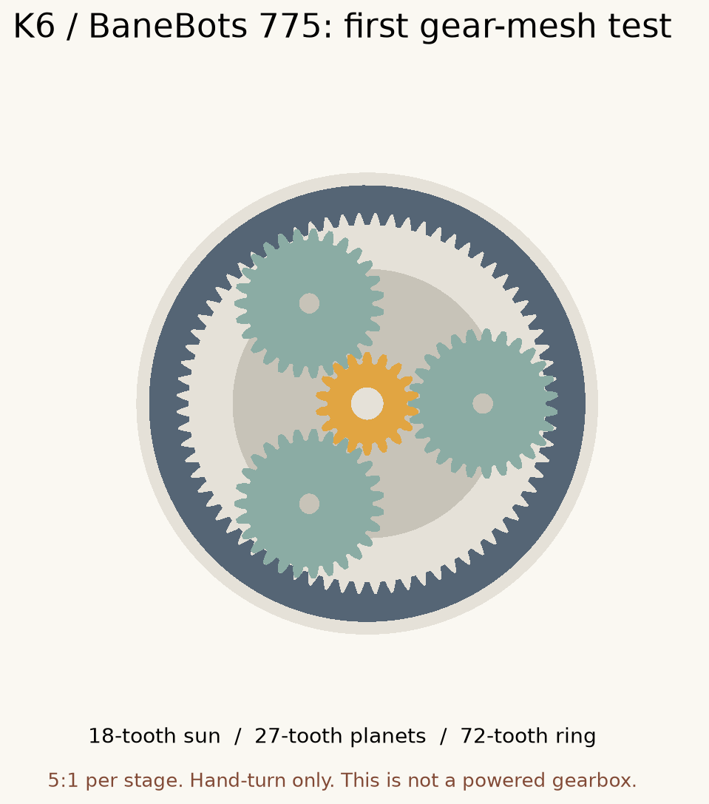

# BaneBots 775 / KINGrinder K6

An experimental compact drive for a KINGrinder K6, using a BaneBots M7-RS775-18 brushed DC motor and a printed planetary reduction gearbox.

**Current status: unpowered fit tests only.** The files here do not form a working motorized gearbox. The 3 mm thick gears and printed carrier pins are for hand turning. Keep the motor disconnected during these tests.



## Start here

1. Print the [5.3 mm](fit-tests/shaft-fit-5.3mm-NO-POWER.stl) and [5.2 mm](fit-tests/shaft-fit-5.2mm-NO-POWER.stl) shaft gauges at 100% scale. Try the loosest first without forcing it onto the shaft.
2. Print the [slotted motor-face template](fit-tests/motor-face-slotted-TEMPLATE-NO-POWER.stl). This checks approximate mounting-hole positions, not an operating mount.
3. Record the actual motor dimensions listed below. The current 29 mm mounting-hole spacing is an assumption.
4. Follow [the print and hand-assembly guide](START-HERE.html) for the optional gear mesh test. Download the repository and open that HTML file locally to see its formatted instructions.

The [fit-tests folder](fit-tests) contains individual printable STLs and editable STEP solids. The [cad folder](cad) contains reference assemblies, not print-in-place models.

## How this extends the upstream project

[Omar Salem's design](https://github.com/Omar-Salem/Nema-17-23-planetary-gear) supplies an editable Fusion reference for a two-stage planetary gearbox, including carriers, bearings, a housing and assembly instructions. Its calculation defaults use two 6:1 stages, giving 36:1 overall. The motor interface is for NEMA 17/23 motors.

We are investigating that architecture for the faster BaneBots motor. The initial fit set in this folder was generated independently with [cq_gears](https://github.com/meadiode/cq_gears), not by modifying the upstream Fusion files. This keeps the experimental geometry reproducible while the motor interface and working-stage design are still being established. The upstream NEMA design remains available at the repository root.

The prototype has an 18-tooth sun, three 27-tooth planets and a fixed 72-tooth ring. The carrier turns once for every five sun turns. Three such stages would give 125:1, but only one thin hand-test stage is included here.

At 12 V, a simple voltage scaling of the manufacturer's 19,500 RPM no-load speed at 18 V estimates 13,000 RPM at the motor and 104 RPM after 125:1 reduction. Actual loaded speed is unknown. This calculation is not a strength rating. The proposed ratio may change after measuring the grinder's load and the motor's behavior.

## Development checklist

- [x] Preserve the upstream source and MIT license in a fork.
- [x] Add editable shaft, bearing-seat and motor-face fit coupons.
- [x] Add one hand-turn gear stage, reference assemblies and print instructions.
- [x] Record CAD validity, mesh and sampled gear-interference checks.
- [ ] Measure the motor face, shaft and grinder connection; print and check fit.
- [ ] Measure K6 running torque and startup peaks with the intended beans and grind setting.
- [ ] Finalize the motor mount and pinion retention.
- [ ] Size the operating teeth, shafts, carrier and housing. Investigate steel planet pins supported at both ends, bearings and stronger later stages.
- [ ] Complete the interstage connections and retained K6 output coupling.
- [ ] Select the power supply and DC controller with appropriate current limiting.
- [ ] Check alignment and no-load operation, then controlled load, temperature and wear.

The 775's high input speed makes the first-stage teeth, lubrication and heat important. The later stages carry greater torque. Stronger filament alone does not establish that either can survive operation.

## Measurements still needed

- Center-to-center distance between the two front motor screw holes.
- Raised locating collar diameter and height.
- Shaft diameter, usable protrusion from the flat motor face and from the collar, and any shaft flat.
- Permitted mounting-screw engagement depth.
- Grinder hex width across opposite flats, usable engagement length and clearance around it.
- Actual handle radius and tangential force while grinding. For a scale reading in kgf, torque in Nm is reading × 9.81 × radius in meters. Record startup peaks separately from running load.

The earlier 3 to 5 Nm discussion was a sizing assumption, not a measured K6 specification.

## Electronics and software

The selected 775 is a brushed DC motor. A suitable DC motor controller with a knob can adjust its speed without an Arduino or custom firmware. Speed under load will vary unless feedback regulation is added. The controller and supply are not yet selected.

The upstream Arduino files concern motor-control and measurement experiments. They are not required for the gears themselves to work. `build.py` here runs on a computer to generate CAD; it does not run on the motor.

## Regenerate the current fit set

The recorded build used Python 3.11. Create a separate environment in this folder:

```sh
python3.11 -m venv .venv
source .venv/bin/activate
python -m pip install -r requirements-lock.txt
python build.py
```

The exact gear-library commit is pinned in `requirements-lock.txt`. `parameters.json` records the current dimensions and assumptions. The `draft_gear_width_mm` value does not generate working-width gears; this release exports only the 3 mm hand-test gears. Labels and fixtures target the current 18/27/72 configuration, so changing tooth counts requires reviewing the generator and assembly rather than treating it as a general gearbox configurator.

## Verification and limits

The [recorded validation](validation.json) reports 13 valid single-solid CAD parts and 13 watertight STL meshes, with zero calculated intersection volume at the initial assembly and at 11 sampled positions over one tooth-mesh cycle. It does not establish printed fit, operation under load, wear life or a permitted speed. No physical testing is claimed.

`artifact-sha256.json` identifies the files associated with this recorded validation. Existing fit files were copied byte-for-byte from the initial prototype. Any later geometry change needs a new report and manifest. The build command overwrites generated files; an old report should not be used to validate a failed or modified build.

## Sources and attribution

- [Original NEMA 17/23 gearbox](https://github.com/Omar-Salem/Nema-17-23-planetary-gear), Omar Salem, MIT license.
- [BaneBots M7-RS775-18 manufacturer data](https://banebots.com/m7-rs775-18/).
- [cq_gears](https://github.com/meadiode/cq_gears), Apache-2.0 licensed dependency. Its library source is not bundled here.
- [VykkuF's K6 motorization example](https://www.reddit.com/r/functionalprint/comments/1mcap06/i_motorised_my_hand_coffee_grinder_for_espresso/) uses a different motor and is supporting anecdotal evidence, not validation of these parts.

Initial variant prepared with Codex on October 21, 2026. See [third-party attribution](THIRD-PARTY.md).
